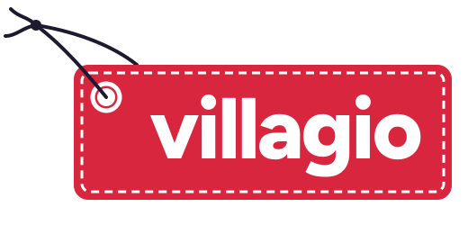

# Villagio

**A hyper-local, club-based marketplace where parents buy and resell their kids' activity gear: sport, music, creative arts.**

> Every September, millions of parents buy a football kit, a violin or a judo gi that their child will outgrow in a year. The gear is still good. It just sits in a cupboard, two streets away from the next family who needs it.

Villagio links those families through the place they already share: **the club, the music school, the neighbourhood.**

---

## At a glance

| | |
|---|---|
| **Stage** | Pre-MVP · admitted to the IESEG incubator (Lille & Paris) |
| **Market** | France · children aged 5–15 · extracurricular equipment |
| **Model** | C2C marketplace with a buyer and seller commission and integrated payments |
| **Team** | Simon, Nathan, Arthur, co-founders |
| **My role** | Product scope and feature architecture · first prototype screens |

---

## The problem

1. **Kids outgrow gear faster than it wears out.** A beginner's kit is used for 6 to 18 months, then left unused.
2. **Starting an activity is expensive and uncertain.** Parents pay full price before they know whether the child will stick with it.
3. **Generalist platforms do the job poorly.** On Vinted or Leboncoin, a size-8 shin guard sits among millions of listings. Nothing tells you whether it fits your child, meets your club's rules, or is sold by a family you can meet after training.

## The insight

The demand for a kid's activity gear is **concentrated in one place: the club.** The family who sells a size-130 judo gi and the family who needs one often train on the same mat. A marketplace built around that community is easier to trust, faster to close and cheaper to grow than a national catalogue.

## The solution

| Pillar | What it does | Why it matters |
|---|---|---|
| **Club marketplaces** | Each sports club or music school gets its own space on Villagio | Built-in trust and liquidity, and the clubs themselves become a distribution channel |
| **Ultra-local by default** | Filter by club, school or neighbourhood, with hand-over in person | No shipping cost, sales close faster, fits how parents already behave |
| **Activity packs** | Ready-made bundles such as "Beginner football pack, 8–10 y/o" | One click replaces five listings and lowers the barrier to try an activity |
| **Guides & labels** | Size and safety guidance per activity (helmet standards, gi sizing…) | Cuts returns and builds expert trust that generalist platforms can't copy |
| **Child profile** *(post-MVP)* | One profile per child: sizes, activities, purchase and resale history | The basis for retention, with timely resale prompts and personalised recommendations |

→ Full detail in [`docs/product.md`](docs/product.md)

## Why it can win

- **Community moat.** Each club that joins brings a ready-made, high-intent group of users. Generalist marketplaces optimise for breadth and can't reproduce that.
- **Natural cycles.** The season starts in September and growth spurts are predictable, which gives the platform a built-in retention rhythm.
- **Tailwinds.** The French second-hand market was worth an estimated **€14bn in 2023** ([Republik Retail](https://www.republik-retail.fr/rse/seconde-main/pratiques/un-marche-de-la-seconde-main-estime-a-14-milliards-d-euros-en-2023.html)), and **40% of French parents report strain from school-related costs** ([CSA for Cofidis, 2024](https://csa.eu/wp-content/uploads/2024/08/2400489-Cofidis-Budget-des-parents.pdf)).

→ Market and positioning in [`docs/strategy.md`](docs/strategy.md)

## Roadmap

| Phase | Goal | How |
|---|---|---|
| **0. Concierge MVP** | Validate demand with real transactions | Landing page, listing forms, manual matching, lightweight automations |
| **1. Marketplace MVP** | First clubs live in one city | Club spaces, local search, integrated payments |
| **2. Retention layer** | Make Villagio the family's activity hub | Child profiles, activity packs, resale reminders |
| **3. Club platform** | Turn clubs into partners | Club dashboards, bulk listings for end-of-season and kit-swap events |

## Build progress

The clickable prototype is under way. The prototype now runs on a **full design system (v1)**: brand guidelines, logo, icons and redesigned pages. **Club spaces**, the core differentiator, are live in demo: a club directory, club pages, and access by club code. Homepage, listings, the publish flow, search, **WhatsApp sharing** and **free give-aways** are built.

→ Milestones in [`docs/build-log.md`](docs/build-log.md)

## Brand

- **Name.** *Villagio* echoes "village": it takes a village to raise a child, and a club to equip one.
- **Signature: « L'étiquette ».** It's the name label sewn into a kid's kit. When gear changes hands, the old first name is crossed out and the new one is written in. Every sale is a relay from one child to the next, and selling is called *« Passer le relais »*.
- **Voice.** One parent talking to another: knowing, energetic, concrete. Sizes, seasons and first names, with no circular-economy jargon.
- **System.** Cerise for the brand, sky blue for large surfaces, deep ink for text, and a single yellow button per screen for the main action. Figtree for the interface, Caveat for handwritten names. Every colour pairing has been checked for contrast (WCAG).
- **Privacy by design.** No child's name ever appears on a public page.

---

## What I worked on

- Defined the **product scope**: functional architecture, MVP vs. post-MVP prioritisation, and the club-marketplace concept
- Built the **competitive analysis** and differentiation strategy against generalist and specialist players
- Designed the **business model** logic and the lean, concierge-first validation plan
- Built the **market survey** and the incubator KPI framework
- Building the **prototype's front end** with AI-assisted development: design system v1, homepage, listings, the publish flow, search and club spaces ([build log](docs/build-log.md))

*The product code lives in a separate, private repository maintained by the team.*

---

Villagio is an early-stage venture. Figures marked as estimates are hypotheses to be validated during the MVP phase.
